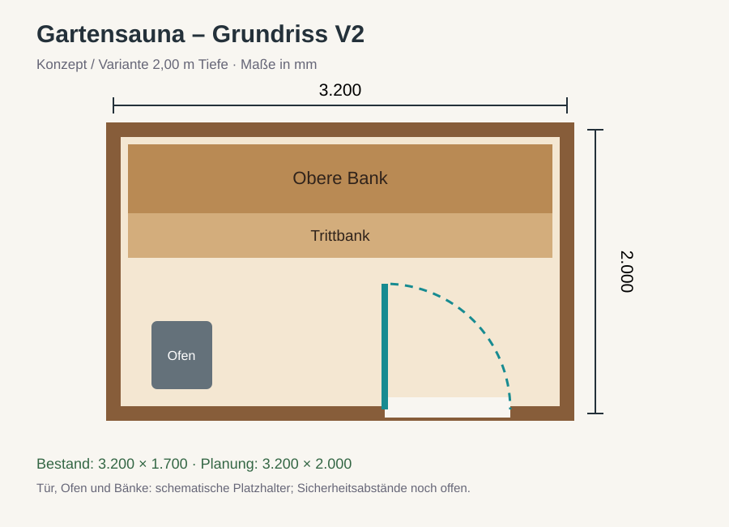
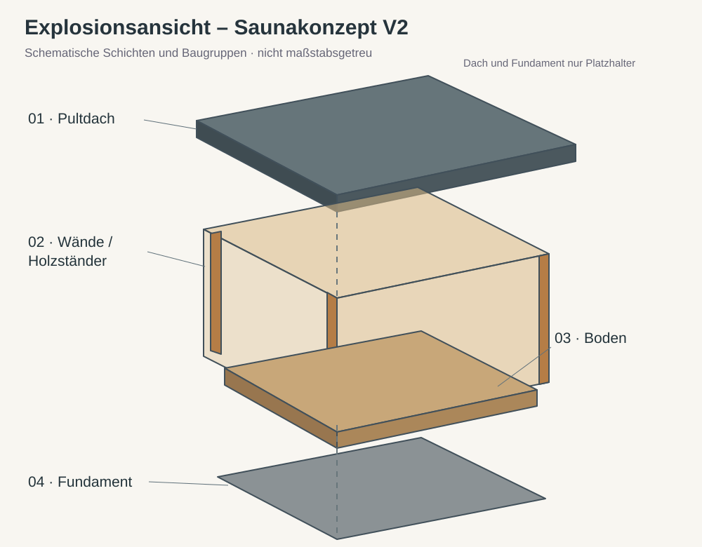
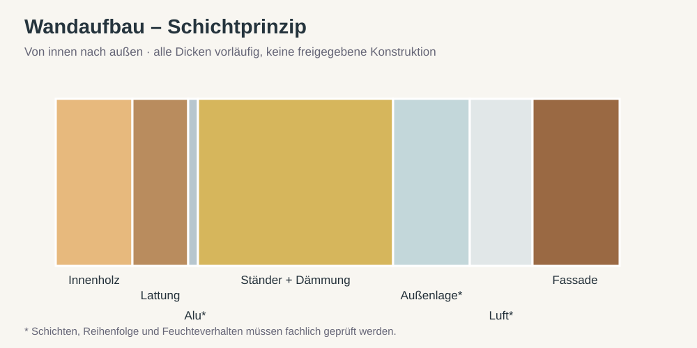
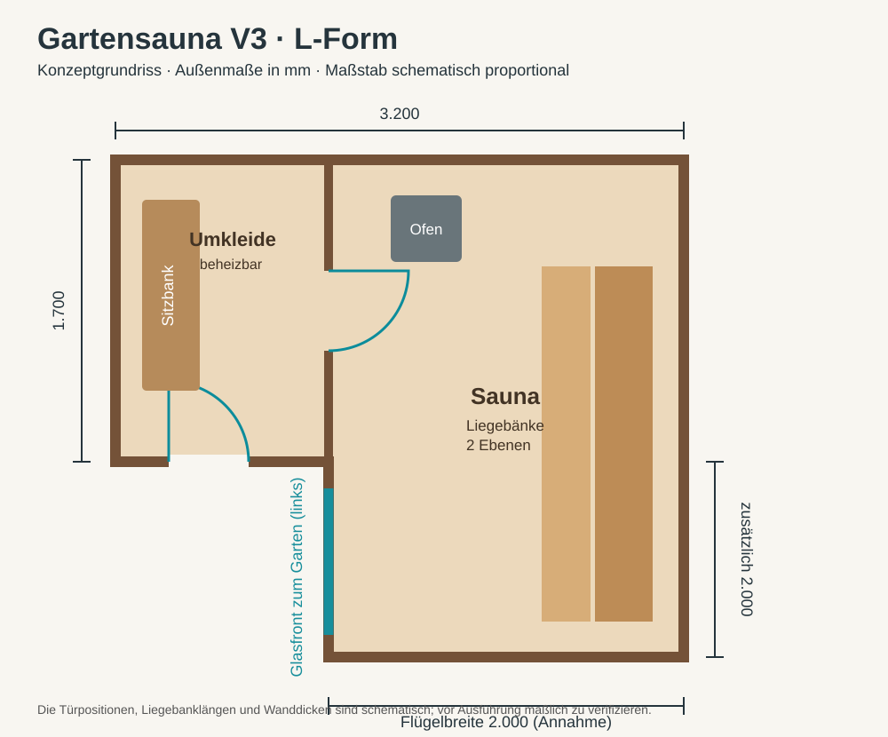

# Gartensauna – CAD & Selbstbau

Planung einer Gartensauna am Standort des bestehenden Holzunterstands. Dieses Repository ist die zentrale Quelle für Maße, Entscheidungen, CAD-Modelle, Bauaufbau, Kosten und Aufgaben.

## Gesicherter Stand (25.10.2026)
- Bestehender Unterstand: **3,20 m lang**, **1,70 m tief** (links, Mitte und rechts), **1,93 m hoch** (gemessener Wert; Messpunkt noch zu klären).
- Eine Erweiterung der Tiefe auf **bis zu ca. 2,00 m** ist möglich.
- Die Höhe ist **variabel**, weil der Unterstand voraussichtlich neu gebaut wird.
- Kein Umbau des Steinturms.
- Vorhandene Fotos zeigen einen Holzunterstand mit Pultdach, Pfosten, OSB-Teilen und Holzlager.

## Vorläufiger Entwurf
Für CAD V1 werden **3,20 × 2,00 m** und eine **vordere Höhe von 2,30 m** als *Annahmen* verwendet, nicht als beschlossene Endmaße. Saunabänke, Tür und Ofen sind Platzhalter.

## Vorgehen
1. Bestandsmaße und Geländesituation vervollständigen.
2. Parametrisches CAD-Modell mit Varianten erstellen.
3. Grundriss, Ofen, Bänke und Lüftung festlegen.
4. Wand-, Dach- und Bodenaufbau bauphysikalisch prüfen.
5. Statik, Brandschutz, Elektroinstallation und lokale Anforderungen prüfen.
6. Stückliste, Kosten und Bauablauf ausarbeiten.

Siehe [Messwerte](docs/measurements.md), [Anforderungen](docs/requirements.md), [Entscheidungen](docs/decisions/README.md) und [Aufgaben](https://github.com/42tg/Gartensauna/issues).

## Visuelle Planung

[Alle Zeichnungen](docs/visuals/README.md) · [Parametrisches OpenSCAD-Modell](cad/sauna.scad)

**Hinweis:** Das OpenSCAD-Modell ist ein neues Konzeptmodell, nicht die zuvor im Chat erwähnte FreeCAD-/STEP-Datei. Bauphysik und Konstruktion sind noch nicht freigegeben.

## Vorentwurf V2

[Maßgeprüfter Konzept- und Angebotsvorentwurf](docs/vorentwurf-v2.md) mit Schichttabelle, Mengengerüst, Bau- und Sicherheitsprüfpunkten. **Keine bauaufsichtliche, statische oder bauphysikalische Freigabe.**

## Aktueller Hauptentwurf: V3 L-Form

- [V3: Konzept und offene Maßfragen](docs/vorentwurf-v3.md)
- [V3: parametrisches 3D-Konzept](cad/sauna-v3.scad)
- V2 bleibt als rechteckige Alternative erhalten. V3 ist noch nicht baufreigegeben.

## Lüftung und Strömungsvergleich

[Öffnungen, Modellannahmen und Kennzahlen](docs/construction/ventilation.md): CAD mit Zuluft, Abluft und Trocknungsklappe; automatisierter 3-D-Luftaltervergleich mit Varianten und Sensitivitätsprüfung. **Isothermes Orientierungsmodell, keine thermische Sauna-CFD.** Ergebnisse im Workflow [Ventilation comparison](https://github.com/42tg/Gartensauna/actions/workflows/ventilation.yml).

## Thermische CFD mit Wärmeauftrieb

[Modell, Prüfungen und Reproduktion](docs/construction/thermal-cfd.md): OpenFOAM berechnet Luftdichte, Temperatur, Auftrieb, Turbulenz und Oberflächenstrahlung gekoppelt. Acht Szenarien einschließlich Kontrollfall ohne Schwerkraft. **Nur numerisch qualifizierte Fälle vergleichen; Randbedingungen sind noch Annahmen.** [Workflow und Ergebnisse](https://github.com/42tg/Gartensauna/actions/workflows/thermal-ventilation.yml).

Zeitabhängige Wärmeauftriebsrechnung: [URANS, Zeitmittel und Zeitschrittprüfung](docs/construction/transient-cfd.md).
