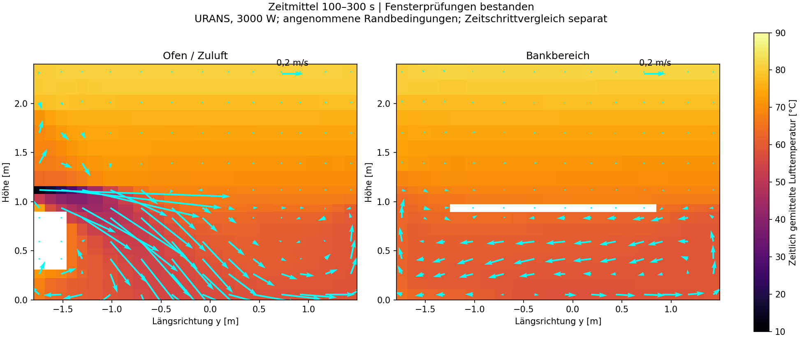
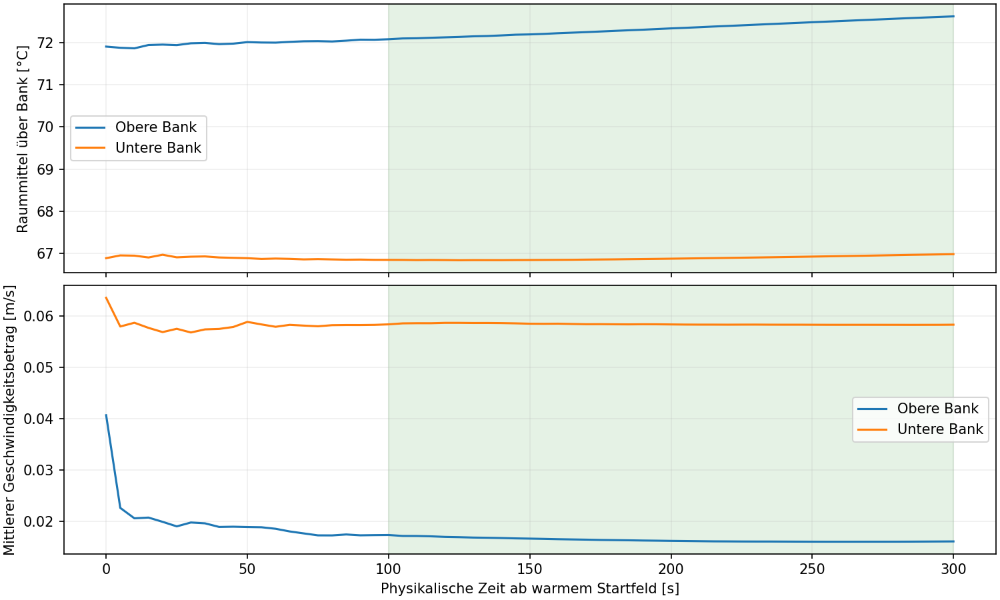

# Zeitabhängige Sauna-CFD – geprüfter Lauf vom 03.11.2026

Zeitmittel von 100 bis 300 Sekunden nach warmem numerischem Start.
**Numerische Fenster- und Zeitschrittprüfungen bestanden.**

| Größe | Basis | Halbierte Zeitschrittgrenze |
|---|---:|---:|
| Obere Bank: Temperatur °C | 72.35 | 72.35 |
| Obere Bank: mittlerer Geschwindigkeitsbetrag m/s | 0.0163 | 0.0170 |
| Untere Bank: Temperatur °C | 66.88 | 66.85 |
| Untere Bank: mittlerer Geschwindigkeitsbetrag m/s | 0.0584 | 0.0597 |
| Betrag Wärmebilanzfehler % | 0.00128 | 0.00128 |
| Unterschied der Fensterhälften K | 0.26450 | 0.24810 |
| Unterschied der mittleren Geschwindigkeit der Fensterhälften m/s | 0.00314 | 0.00289 |

Mittlere absolute Feldabweichung beim Halbieren der Zeitschrittgrenzen: **0.1221 K**, **0.00509 m/s**.

Die Energiebilanz enthält die Änderung der im Luftvolumen gespeicherten Energie; die Massenbilanz enthält die Änderung der Luftmasse. Das ist keine stationäre Bilanz.

Luftalter: noch nicht als Vergleichswert freigegeben. Empfindlichkeit gegenüber den zwei Startfeldern: 75.1 % / 75.1 %.
Der Luftaltertransport wird aus gespeicherten Strömungsfeldern implizit nachgerechnet; er ist keine direkt mit jedem CFD-Schritt gekoppelte Messgröße.

Annahmen: 3000 W mittlere Ofenwärme, 80 m³/h Zuluft bei 10 °C; vereinfachte geschlossene Ofen-/Bankhüllen. Trockenes URANS-Modell mit Oberflächenstrahlung. Keine Aufheizzeit realer Steine/Hölzer, kein Aufguss, keine Messvalidierung. Ein Zeitschrittvergleich ersetzt keine räumliche Gitterstudie und keinen Nachweis statistischer Unabhängigkeit.

## Einordnung und Herkunft

Die Zahlen wurden lokal auf dem unveränderten CAD-Rechengitter mit 7359 Zellen berechnet. Das vorgewärmte Startfeld stammt aus der vorherigen lokalen stationären Diagnose bei Iteration 8000. Die parallele Fortsetzung begann an gespeicherten physischen Zeitständen von 90 s bzw. 45 s. Beide ausgewerteten Zeitfenster wurden vollständig mit vier MPI-Prozessen gerechnet. Die [Rohkennzahlen und Provenienz](transient-cfd-results-2026-11-03.json) enthalten Anfangsfeld-Hashes, tatsächliche Schrittgrößen, Code-Hashes und beide Konfigurationen.

Acht Python-Tests, beide Netzprüfungen und beide zeitabhängigen Solverläufe bestehen. Der neue GitHub-Workflow ist zum manuellen Wiederholen eingerichtet; dieser Ergebnisbericht behauptet keinen bereits ausgeführten GitHub-Lauf. Der Workflow erzeugt sein warmes Startfeld neu bei Iteration 4000 und muss dessen eigene Mittelwerte erneut prüfen.

Die obere Banktemperatur steigt im betrachteten Fenster noch langsam: Die beiden 100-s-Hälften unterscheiden sich dort um ungefähr 0,28 K. **Die Mittelwerte sind Werte dieses Zeitfensters, keine nachgewiesenen endgültigen Gleichgewichtstemperaturen.** Der Bilanzfehler ist kein Genauigkeitsversprechen für reale Saunatemperaturen. Die Startabhängigkeit des Luftalters beträgt weiterhin rund 75 %; daraus wird keine Rangfolge von Lüftungspositionen abgeleitet.

## Berechnete Bilder

Basislauf, Mittelung von Sekunde 100 bis 300. Die cyanfarbenen Pfeile zeigen projizierte, zeitgemittelte Geschwindigkeitsvektoren, keine erfundenen Stromlinien.

Die grün markierte Fläche kennzeichnet das ausgewertete Zeitfenster. Der Start bei warmer Luft ist keine Simulation des Aufheizens realer Steine und Hölzer.

[Modell, Grenzen und Reproduktion](transient-cfd.md)
