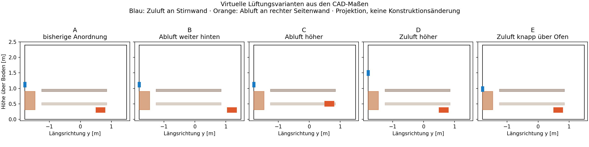

# Vergleich von fünf Lüftungspositionen

Studie `ventilation-positions-2026-11-03`. 60 simulierte Minuten pro Lauf, Zeitmittel Minuten 50–60.

**Vergleich noch unvollständig oder nicht ausreichend konvergiert. Keine vollständige Rangfolge freigegeben.**

| Variante | Zustand | ungünstigere Bank: Luftalterfaktor ↓ | P95 mittleres Luftalter min | obere / untere Bank °C | P95 mittlere Geschwindigkeit m/s |
|---|---|---:|---:|---:|---:|
| A · bisherige Anordnung | fehlt / abgebrochen | — | — | — | — |
| B · Abluft weiter hinten | fehlt / abgebrochen | — | — | — | — |
| C · Abluft höher | fehlt / abgebrochen | — | — | — | — |
| D · Zuluft höher | fehlt / abgebrochen | — | — | — | — |
| E · Zuluft knapp über Ofen | fehlt / abgebrochen | — | — | — | — |

## Aussage zur Rangfolge

Primärkriterium ist der Luftalterfaktor der schlechter versorgten Bank. Es wird kein willkürlich gewichteter Gesamtscore aus Temperatur, Frische und Geschwindigkeit gebildet.
Vorläufige nominale Frischegruppen der qualifizierten Teilmenge (überlappende Vergleichsbänder werden zusammengefasst): noch nicht verfügbar.
Die Reihenfolge gilt nur unter den nominalen Modellannahmen. Die Robustheitsprüfung umfasst ausschließlich die ausgewählten Finalisten; ausgeschiedene Varianten wurden nicht in allen Betriebsfällen geprüft.
**Kein belastbar getrennter Sieger der Finalisten nachgewiesen.** Das kann an Gleichwertigkeit, Zielkonflikten, Rangwechseln oder fehlenden Prüfungen liegen.

## Prüfungen der Finalisten

| Variante | Fall | Qualität | ungünstigerer Luftalterfaktor |
|---|---|---|---:|

## Grenzen

3 kW mittlere Wärmeabgabe; nominal 80 m³/h Zuluft bei 10 °C. Vereinfachte geschlossene Ofen- und Bankhüllen, keine Personen oder Aufgüsse. Der Emissivitätsfall verändert nur die Ofenoberfläche von 0,9 auf 0,5 und prüft eine angenommene Wärmeverteilung; er ersetzt keinen durchströmten Steinkorb und keine Messvalidierung.
Die Vergleichsbänder sind Mindestabstände für eine vorsichtige Ingenieurentscheidung und beobachtete Gitter-/Zeitschrittempfindlichkeit, keine statistischen Konfidenzintervalle. Die thermischen Zielkonfliktgrenzen (2 K und 0,02 m/s) sind gewählte Vergleichsregeln, keine Komfort- oder Sicherheitsnormen.
Der Durchsatz ist vorgeschrieben. Ventilator-, Kanal- und Gitterdruckverluste werden nicht ausgelegt. Eine spätere Bauentscheidung erfordert auch deren Prüfung.

[Rechenlauf und ausführliche Artefakte](https://github.com/42tg/Gartensauna/actions/runs/41668842137)

