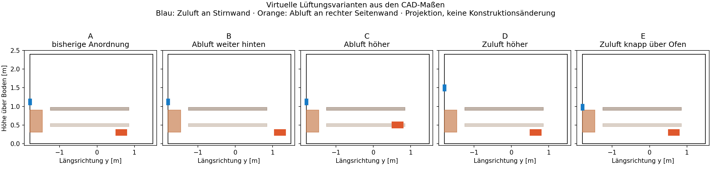

# Fünf Lüftungspositionen – Vergleichsplan

Stand 03.11.2026. Vom Nutzer beauftragte numerische Vergleichsstudie; **noch keine entschiedene Bauvariante**. Die virtuellen Öffnungen verändern das vorhandene Bau-CAD nicht. Alle übrigen Raum-, Bank- und Ofenmaße stammen aus dessen OpenSCAD-Metadaten.

## Festgelegte Kandidaten

Alle Höhen beziehen sich auf die Öffnungsmitte über dem Saunaboden. Zuluft jeweils an der Stirnwand über dem Ofen; Abluft jeweils an der rechten Außenwand. Die x-/y-Koordinaten sind CAD-Koordinaten, keine Abstände von einer beliebigen Außenkante.

| Variante | Zuluftmitte | Abluftmitte | Abluft y-Mitte | Änderung gegenüber A |
|---|---:|---:|---:|---|
| A – bisherige Anordnung | 1120 mm | 300 mm | 650 mm | Referenz |
| B – Abluft weiter hinten | 1120 mm | 300 mm | 1200 mm | Abluft 550 mm weiter vom Ofen entfernt |
| C – Abluft höher | 1120 mm | 500 mm | 650 mm | Abluft 200 mm höher, weiterhin unter oberer Bank |
| D – Zuluft höher | 1500 mm | 300 mm | 650 mm | Zuluft 380 mm höher |
| E – Zuluft knapp über Ofen | 980 mm | 300 mm | 650 mm | Zuluft 140 mm tiefer; Unterkante 40 mm über Ofenhülle |

Zuluftfläche jeweils 150 × 80 mm = 0,012 m², Abluftfläche 300 × 160 mm = 0,048 m². Grundlast: 80 m³/h bei 10 °C, 3000 W mittlere gesamte Ofenwärme, unveränderte Hüll-Leitwerte. Tür und Trocknungsöffnung geschlossen. Es handelt sich um homogenisierte Öffnungen; Lamellen-Druckverlust und lokale Strahlform sind nicht aufgelöst.



Die Zeichnung projiziert verschiedene x-Lagen auf die y-z-Ebene. Insbesondere liegt die Abluft von C an der rechten Wand und kollidiert nicht mit der weiter innen liegenden unteren Bank. Der Zeichnung sind keine zusätzlichen Bohrungen im Bau-CAD hinzugefügt worden.

Geometrisch geprüft: gleicher Luftinhalt und gleiche Öffnungsflächen, Außenwandlage, freie Öffnungen ohne Überschneidung mit Ofen-/Bankhüllen, gesamte Abluftöffnung unter 600 mm. Nicht damit geprüft: Ständer-/Leitungsdurchführungen, Ventilzugang, Abdichtung, Fühlerabstände und die endgültige gewählte Ofen-/Steuerungskombination.

Herstellerreferenz: [HUUM DROP 2.0 EU v6, S. 12–13](https://huum.eu/wp-content/uploads/2026/01/DROP_2_0_User_Manual_EU_v6_WEB.pdf), erneut gelesen am 03.11.2026. Für mechanische Lüftung beschreibt HUUM eine Zuluft auf Ofenmitte oder höher, gegenüberliegende niedrige Abluft und eine während des Saunierens geschlossene Trocknungsöffnung. Eine hohe Betriebsabluft an der Trocknungsöffnung wird deshalb hier nicht als gleichwertiger Baukandidat behandelt.

## Rechenfolge und begrenzter Aufwand

1. Alle fünf Fälle: 1000 SIMPLE-Iterationen nur zur numerischen Initialisierung, danach **3600 Sekunden URANS**, Ausgaben alle 5 s, Mittelung **3000–3600 s**. Keine Gleichsetzung von SIMPLE-Iterationen und physikalischen Sekunden.
2. Nur qualifizierte Fälle kommen in die vorläufige Frischluftreihenfolge. Die ersten zwei werden Finalisten.
3. Jeder Finalist erhält fünf eigenständige Langläufe: feineres Gitter (12 statt 16 cm Maximalteilung), halbierte Zeitschrittgrenzen, 60 m³/h, 100 m³/h und Ofen-Emissivität 0,5 statt 0,9. Gitter- und Zeitschrittänderung sind getrennt. Die Emissivität der anderen Oberflächen bleibt unverändert.
4. Automatischer Bericht mit Zahlen, Gruppen praktisch gleichwertiger Varianten, Zielkonflikten, fehlenden/fehlgeschlagenen Rechnungen und gegebenenfalls einem robusten Gewinner **zwischen den geprüften Finalisten**.

Das sind fünf Hauptläufe und höchstens zehn zusätzliche Läufe. Jeweils maximal fünf parallele Jobs, zwei MPI-Prozesse pro Job und fünf Stunden Solver-Laufzeit pro Fall. Bei Zeitüberschreitung oder Divergenz bleiben Diagnose und ein kompakter Neustart erhalten; es wird kein Ergebnis erfunden. Die Rechenserie kann mehrere Stunden dauern. Log-/Ergebnisartefakte bleiben drei Tage, der Abschlussbericht sieben Tage; Bericht und Positionsbild werden zusätzlich automatisch auf `main` gespeichert. Umfangreiche Roh-Zeitschrittordner werden nicht in Actions-Artefakte dupliziert.

## Was eine Zahl freigibt

Die bisherigen transienten Bilanz- und Fensterprüfungen gelten weiter. Zusätzlich muss das Luftalter:

- aus zwei verschiedenen Anfangsfeldern über beiden Bänken auf höchstens 5 % Unterschied kommen;
- zwischen den beiden Mittelungsfensterhälften über beiden Bänken um höchstens 5 % variieren;
- bei Verdoppelung des Zeitschritts der nachgelagerten Luftalterberechnung um höchstens 3 % variieren.

Die letzte Prüfung betrifft die zeitliche Abtastung des Luftaltertransports; die CFD-Zeitschrittprüfung ist separat. Der Luftaltertransport erfolgt aus gespeicherten Massenflüssen und berücksichtigt die Änderung der Luftmasse pro Zelle. Ein nicht bestandenes Kriterium sperrt den Fall für die Auswahl, statt durch nachträglich gelockerte Schwellen einen Sieger zu erzeugen.

Primärkriterium: **Luftalterfaktor der schlechter versorgten Bank** (Maximum beider Bankmittel), kleiner ist günstiger. Ergänzend: P95 des zeitgemittelten Luftalters, Temperaturen über beiden Bänken, P95 des zeitgemittelten Geschwindigkeitsbetrags und Wärmeabgabe über die Öffnungen. P95-Werte sind räumliche Perzentile zeitgemittelter Felder, keine kurzzeitigen Spitzenwerte.

Nominale Vergleichsbänder: mindestens ±10 % um den Faktor; bei den Finalisten erhöht eine größere beobachtete Gitter-/Zeitschrittänderung diesen Abstand. Überlappende Bänder bilden gemeinsame Gruppen. Das sind **keine statistischen Konfidenzintervalle** und kein vollständiger Grid-Convergence-Index.

Ein robuster Finalistensieger muss in sämtlichen geprüften Betriebsfällen getrennt günstigere Frische liefern, ohne den ungünstigen Luftalter-P95 entsprechend zu verschlechtern. Außerdem darf seine kältere Bank nicht mehr als 2 K kälter und sein P95-Tempo nicht mehr als 0,02 m/s höher sein als beim anderen Finalisten. Diese Grenzen sind vorab gewählte Entscheidungsregeln, keine Komfort-/Sicherheitsnormen. Bei Rangwechseln oder Zielkonflikten bleibt die Empfehlung offen.

## Aussagegrenze

Die Studie ergibt eine Planungsrangfolge **innerhalb dieses Modells und der genannten Bedingungen**. Die geschlossene Ofenhülle bildet keinen durchströmten HUUM-Steinkorb ab. Der Emissivitätsfall prüft nur eine plausible Variation des angenommenen Strahlungs-/Konvektionsanteils; 0,5 ist kein belegter HUUM-Messwert. Personen, Aufguss, Feuchte, realer Thermostat, Lamellen und Ventilatorkennlinie fehlen.

Die Robustheitsläufe umfassen die ausgewählten Finalisten. Daraus folgt keine unter allen Betriebsbedingungen abgesicherte Gesamtreihenfolge der anderen drei Kandidaten. Für eine experimentell bestätigte Bauempfehlung fehlen weiterhin Messdaten bzw. ein besser belegtes Ofenmodell.

## Start und Ergebnis

Workflow: **Ventilation position study**, manuell oder bei Änderung der Studienkonfiguration/Workflowdatei. Gewöhnliche CAD-/Textänderungen starten diese aufwendige Reihe nicht automatisch. Zentral: `simulation/ventilation-study.json`.

```sh
python scripts/study_run.py A_current
python scripts/study_report.py --root build/study-artifacts --select
python scripts/study_report.py --root build/study-artifacts --out build/study-report
```

[Automatisch aktualisierter Ergebnisbericht](ventilation-study-results.md). Ein unvollständiger Bericht bedeutet ausdrücklich nicht, dass die Vergleichsreihe schon bestanden hat.
