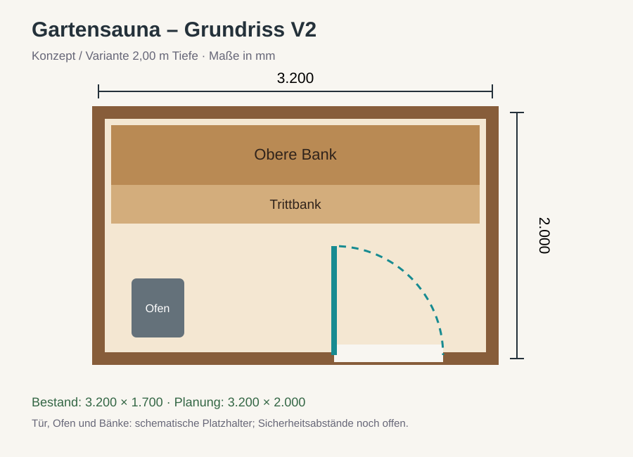
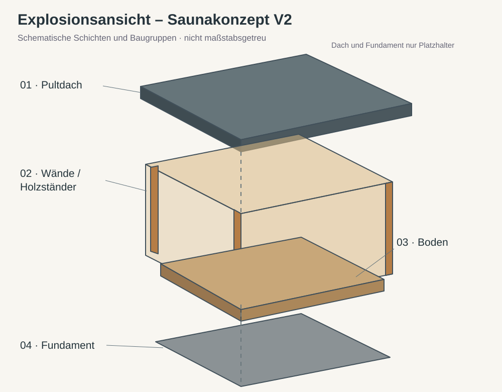
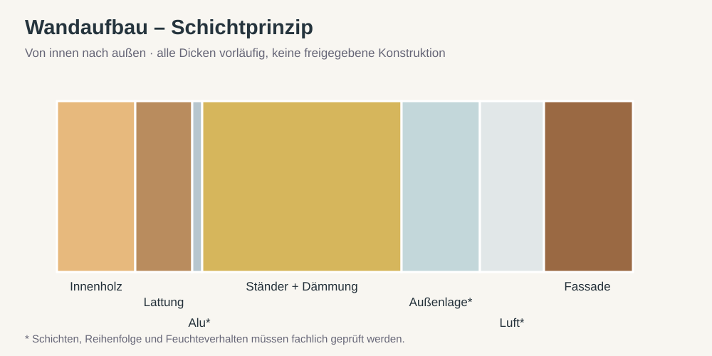

# Visuelle Planung

## Grundriss

## Explosionsansicht

## Wandaufbau – Prinzip

Alle Ansichten sind **Konzeptzeichnungen**, keine fertigen Bauzeichnungen. Insbesondere Wandaufbau, Ofenabstände, Dach und Fundament sind noch zu prüfen.

Das 3D-Modell liegt unter [cad/sauna.scad](../../cad/sauna.scad). OpenSCAD: `variant = "bestand"` oder `"planung"`; `view = "assembled"`, `"exploded"` oder `"structure"`.
