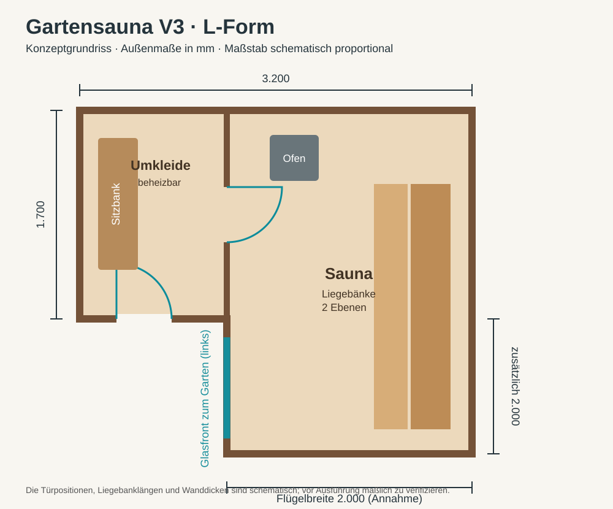

# V3 – L-förmige Gartensauna (Hauptentwurf)

**Status: Vorentwurf / Layout-Variante, nicht bau- oder maßtechnisch freigegeben.** Stand 25.10.2026.

## Konzept
- Linker Bestandsbereich als **kleine, beheizbare Umkleide mit einem Stuhl (Standard), optional zwei Stühlen**; keine große Ruhezone erforderlich.
- Zugang von außen links.
- Durchgang durch eine zweite, innenliegende Tür in den rechten Saunaflügel.
- Rechte Wand des Saunaflügels mit Liegebänken; **vollflächige Glasfront an der linken Längsseite des Saunaflügels**, bodentief bis zur Dachunterkante, mit Blick in den Garten (vom Saunaflügel aus gesehen).
- Der alte Unterstand wird abgerissen; der Entwurf ist ein Neubau. Alte Pfosten und Dach begrenzen ihn nicht.

## Geometrie und offene Interpretation
| Parameter | Wert | Herkunft |
|---|---:|---|
| Bisheriger Unterstand, Gesamtbreite | 3.200 mm | gemessen; Altbestand, keine Neubaugrenze |
| Neubau, Gesamtbreite | 3.707,5 mm | abgeleitete vorläufige Planung; Nachmessung ausstehend |
| Vorraum, lichte Breite | 1.400 mm | vorläufig beschlossen, ADR 0013 |
| Bisheriger Unterstand, Tiefe | 1.700 mm | gemessen |
| Zusätzliche Ausdehnung rechter Flügel | 2.000 mm | Nutzerangabe; Richtung im Gelände noch bestätigen |
| Breite rechter Flügel | 2.000 mm | **Entwurfsannahme** |
| Lichte Innenhöhe | 2.200 mm | beschlossen 13.11.2026; Fertigboden bis fertige Decke |
| Dachoberkante über Fertigboden | 2.481 mm | 2.200 + 281 mm Dachaufbau; zusätzliches Gefälle noch offen |
| Wanddicke | 205 mm in CAD-V3.1 | Planungsaufbau, siehe Hüllaufbau; nicht baufreigegeben |

Bei dieser Interpretation beträgt die Gesamtausdehnung in der Tiefe **3.700 mm** (1.700 + 2.000). Der rechte Flügel bleibt 2.000 mm breit. Seit ADR 0013 erhält der Vorraum 1.400 mm lichte Breite: 205 mm Außenwand plus 102,5 mm Versatz bis zur linken Trennwandfläche ergeben 1.707,5 mm bis zum Flügelbeginn und insgesamt 3.707,5 mm Neubau-Gesamtbreite. Diese Breite muss vor Ort bestätigt werden. Die lichte Vorraumtiefe bleibt 1.290 mm; der Raum ist damit noch keine großzügige Ruhezone.

Die Tür-/Bankpositionen in der Zeichnung sind schematisch. Aktuell sind zwei 600 × 2100-mm-Liegeflächen geometrisch nachgewiesen; Bewegungsflächen siehe V3.1.

## Dateien
- [Bemaßtes schematisches Layout](visuals/grundriss-v3.svg)
- [Parametrisches OpenSCAD-Konzept](../cad/sauna-v3.scad)
- [Rechteckige Variante V2](vorentwurf-v2.md) bleibt erhalten.

## Prüfpunkte vor baulicher Planung
Grundstücksgrenze/Abstandsrecht, Bestandsmauer, Fundament, Dachhöhe/Neigung, Ofen-/Glasabstände, Tragfähigkeit, Feuchteschutz, Lüftung und Elektroinstallation. Es liegt kein fachlicher Nachweis vor.

## Korrektur 25.10.2026 – Ausrichtung der Glasfront
Die Verglasung liegt ausdrücklich **links am rechten Saunaflügel** und blickt in den Garten. Die bisherige Stirnseitenverglasung war falsch. Öffnungsmaße, Anschluss an den Umkleidebereich und endgültige Liegebankanordnung sind weiter zu prüfen.

## Nutzeranforderung – Sitzplätze in der Umkleide
Ein Stuhl genügt, optional zwei. Die bisherige durchgehende Sitzbank ist nicht erforderlich. Platz für Garderobenhaken, Umziehen und den Durchgang zur Sauna erhalten. Die Umkleide soll beheizbar bleiben. Die CAD-Möblierung muss entsprechend aktualisiert werden.

## Vollflächige Glasfront – 25.10.2026
Die gesamte gartenseitige Front des vorspringenden Saunaflügels wird verglast: keine geschlossene Brüstung und kein geschlossener Wandstreifen über dem Fenster. Im aktuellen Konzept sind das 2.000 mm Breite × 2.200 mm Höhe (beschlossene lichte Innenhöhe vom 13.11.2026), von Oberkante Boden bis Unterkante Dach. Rahmen, Tragwerk und Glasaufteilung sind noch nicht konstruiert; 40 mm im CAD sind ein Platzhalter für den Glasaufbau.

## Konkretisierung V3.1 – 26.10.2026

Maßgebend ist der [aktuelle Hüllaufbau](construction/insulation.md): 205 mm Wand, 281 mm Dach, 160 mm Dachdämmung. Lichte Innenhöhe seit Entscheidung 0012: 2200 mm. Gang am Glas 520 mm, Standfläche hinten 645 mm. Umkleide seit ADR 0013 lichte 1400 × 1290 mm; Gesamtbreite vorläufig 3707,5 mm. Tiefe und Saunaflügel unverändert; Dachoberkante seit Entscheidung 0012 bei 2481 mm über Fertigboden. [Aktuelles Detailmodell](detailmodell.md).
